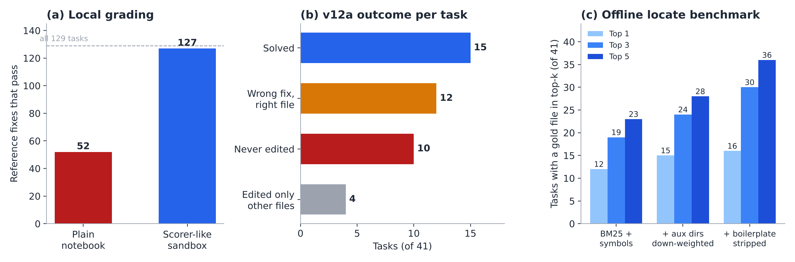
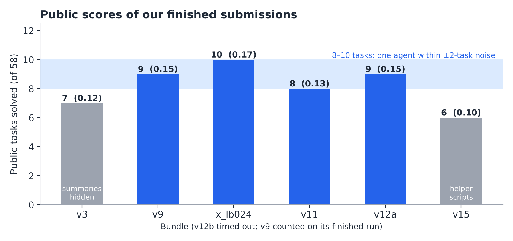

# Where Gemma 4 Coding Agents Lose Tasks: Environment, Noise, Time and Localization

**Author:** Ritu Raj Patel (Synergon AI) · **Kaggle:** kamal3501 · **Code and logs:** https://github.com/kamaljaiswal/kaggle_gemme_4 · **Written:** 10 November 2026

## Abstract

We spent the Gemma 4 Developer Agent competition trying to improve a single-agent baseline built on `gemma-4-31b-it-qat-w4a16-ct`, and most of what we learned is about measurement rather than about agents. Four findings stand out. First, local evaluation in a plain Kaggle notebook grades most tasks wrongly: only 52 of the 129 public reference fixes pass there, while a sandbox rebuilt to match the scorer's image passes 127 (Kirchner, 2026), and all 41 of our sampled tasks. Second, the public leaderboard is coarse and noisy: one task is worth 0.017, identical submissions differ by about 2 tasks, and our four comparable bundles scored 8, 9, 9 and 10 of 58, which is one agent, not four. Third, the binding constraint is the 12-hour total, not the per-task cap: two of our bundles that kept the per-task cap timed out because more tasks used it fully. Fourth, in a correct sandbox our best bundle solves 15 of 41 tasks, and of its 26 failures, 10 never edited a file; the agent was still paging through code when its tool budget ran out. A deterministic locate script raises the rate at which the right file appears in the top five candidates from 23 to 36 of 41 offline, yet the full script bundle we built around it scored our worst result (0.10). We report the negative result, the harness facts we measured, and the tools that made the measurements possible.

*Figure 1. Three findings. (a) Of 129 public reference fixes, 52 pass in a plain notebook and 127 in a scorer-like sandbox. (b) v12a on 41 tasks in the corrected sandbox: 15 solved; of 26 failures, 10 never edited a file. (c) Top-k file localization of the offline locate script, by version.*

## 1. Introduction

The competition asks for a coding agent, configured in YAML on top of a fixed harness, that fixes real GitHub issues. Each submission runs about 120 hidden tasks on 4×L4 GPUs with vLLM, a 32,768-token context and a 12-hour limit; a task counts only if every hidden test passes. The public leaderboard scores 58 of those tasks. Participants control the model variant, sampling settings, prompts, tool list, per-task limits (tool calls, minutes, turns, command timeout), sub-agents, skills and LoRA adapters.

We began, like many teams, by tuning prompts and settings against public scores. That approach stalled at 0.15 ± 0.02 for reasons that turned out to be structural. This writeup documents those reasons, so that other teams can spend their submissions on changes that can actually be detected.

Our contributions:

1. A measurement of how badly an unmodified notebook sandbox misgrades tasks, and a runner that grades in a scorer-like sandbox with a reference-patch check before every run.
2. A quantitative account of leaderboard noise from our own repeats and from the public score distribution.
3. Two time-limit failures and why the per-task cap does not protect the 12-hour total.
4. A failure audit of 41 tasks in the corrected sandbox, and an offline benchmark for file localization.
5. A negative result: deterministic helper scripts that looked strong offline lowered the public score.
6. Harness facts measured with probe bundles.

## 2. Setup

**Base agent.** All our bundles use the 31B model with one agent and six harness tools (`run_command`, `read_file`, `edit_file`, `write_file`, `get_status`, `submit_patch`). The starting point was a public "budget-aware" single agent, then a forum bundle reported at 0.24 (`x_lb024`: 28 tool calls, 7 minutes per task, output limit 6,144 tokens, thinking budget 4,096, targeted `pytest -k` checks). Our main later variant, `v12a`, differs only in a thinking budget of 2,048.

**Public practice set.** 129 tasks: fastapi 67, rich 48, requests 13, httpx 1.

**Process.** Every bundle is validated and zipped by a script that checks the zip layout byte for byte against the bundle; every upload is logged with its hash, the change and the score (`submissions/LOG.md`). The runner notebook (`notebooks/`) runs any set of bundles on the same tasks in one GPU session.

## 3. Local evaluation was measuring the environment

Our first local runs reported 27.5% resolved for the public baseline across 236 attempts, which looked healthy. A later public analysis checked the harness's own grader with the reference patches as the "agent" output. In a plain Kaggle notebook only 52 of 129 pass: fastapi 10 of 67, requests 3 of 13, rich 39 of 48, httpx 0 of 1 (Kirchner, 2026). The notebook's sandbox sees every Kaggle package (for example an IPython Pygments lexer, or langsmith loading itself as a pytest plugin), installs none of the competition's test wheels, and lacks over 50 test-only packages. Rebuilding the sandbox from the published `Dockerfile.sandbox` (clean environment, pytest 8.4.2, competition wheels, shims, and a small per-task version calibration for old public tasks) raises this to 127 of 129; the remaining two require tests with contradictory skip conditions and cannot pass anywhere.

Our runner graded in exactly the broken configuration. Of 19 "tests failed" results in our early ledgers, 5 ended with pytest exit code 2, an import or collection error. In a 12-task set where 7 tasks were fastapi and 2 were requests, most "failures" were unpassable, which explains why every bundle solved the same four tasks and no comparison ever separated bundles.

We adapted the scorer-like sandbox into our runner (with attribution, Apache 2.0) and added a gold check: before the model starts, the reference patch of every selected task is graded on CPU. On our 41-task sample, 41 of 41 passed. Only after that check do local failures mean that the agent failed.

**Lesson.** Before comparing agents locally, grade the reference patches in the same environment. A local number without that check is not interpretable.

## 4. The leaderboard cannot see small improvements

Scores are counts out of 58, truncated to two decimals, so 0.17 is 10 tasks and 0.18 is 11. In a snapshot of 4,018 teams on 28 October (harshitsama, 2026), the distribution was: 14 tasks (0.24) 6 teams, 13 tasks 48, 12 tasks 218, 11 tasks 571, 10 tasks 689, 9 tasks 581, 8 tasks 397. The median team solved 9 tasks.

Run-to-run noise is about 2 tasks. Another team measured it over 200 or more runs of one configuration; variance comes only from "flippy" tasks, which an agent sometimes solves and sometimes does not (Johnson, 2026). Our own evidence agrees: the same files scored 0.24 for the forum author and 0.17 for us, and the public baseline has been reported at 0.22, 0.17, 0.13 and 0.13.

Our scored submissions:

| Bundle | Change against its parent | Public score (tasks) |
|---|---|---|
| v3_overflow_fix | Output 6,144, thinking 2,048, thought summaries hidden | 0.12 (7) |
| v9_edit_safety | Prompt fixes, whole-test-file checks, 8 min | Timeout, then 0.15 (9) |
| x_lb024 | Forum bundle: 7 min, targeted tests | 0.17 (10) |
| v11_lb024_fixes | x_lb024 + three prompt fixes | 0.13 (8) |
| v12a_think2048 | x_lb024 with thinking 2,048 | 0.15 (9) |
| v12b_calls40 | v12a with 40 tool calls | Timeout |
| v15_scripted | v12a + helper scripts (Section 7) | 0.10 (6) |

The four comparable bundles with thought summaries on (v9, x_lb024, v11, v12a) scored 8 to 10 tasks. Under a 2-task noise floor they are statistically the same agent: none of the prompt or thinking-budget changes is detectable from one public run each. This matches a 129-task local sweep by another team, in which temperature (0.0 to 1.0), top-p, thinking budget (2,048 to 6,144), an analyzer sub-agent and the graph tools all stayed within noise, while disabling thinking (23 vs 48 of 129) or hiding thought summaries (35 vs 51) did not (Thakur, 2026). Our only bundle with summaries hidden, v3, has our second-lowest score.

**Lesson.** With one submission a day, use the leaderboard to confirm that a bundle finishes and is not broken, and use paired local runs in a correct sandbox to rank bundles.

*Figure 2. Public tasks solved (of 58) by our finished submissions. The four bundles with thought summaries on lie within a 2-task band (8–10); v3 hid summaries and v15 added helper scripts.*

## 5. The 12-hour limit binds before the per-task cap

The time budget is about 5.5 minutes per task on average once startup is included. Two of our submissions ran past 12 hours and scored nothing, while still using a daily slot.

- **v9** asked the agent to run the whole test file after editing, with an 8-minute cap. The same zip timed out once and finished once (0.15), so it sat at the edge.
- **v12b** changed one number: 40 tool calls instead of 28, with the 7-minute cap unchanged. No single task could run longer than before, but tasks that used to stop at 28 calls now ran to the cap. In our corrected-sandbox run of v12a, 13 of 41 tasks already ended on the call or time limit; raising the call limit moves those tasks to the full 7 minutes. A 12-task timing check in our old sandbox had predicted 8.6 hours; it was too optimistic because missing packages made tests fail fast.

v12a in the corrected sandbox took 315 s per task on average (90th percentile 423 s), which projects to about 10.5 hours for 120 tasks plus startup. The x_lb024 settings (28 calls, 7 minutes) finished within 12 hours on all five scored runs that used them: four of ours (x_lb024, v11, v12a, v15) and the forum author's.

**Lesson.** Judge time on a sample that includes hard tasks, in the correct sandbox, and report the slowest tenth and the number of tasks that hit a limit, not only the mean. Treat any change that lets failing tasks run longer as a time risk, whatever the per-task cap says.

## 6. Where the agent fails

We ran v12a on 41 tasks sampled by repository from the 126 gradable public tasks, in the corrected sandbox. It solved 15 (37%): fastapi 5 of 21, rich 7 of 15, requests 3 of 4, httpx 0 of 1. The 26 failures split as follows:

| Outcome | Tasks |
|---|---|
| Never edited any file | 10 |
| Edited a file the reference fix changes, but the fix was wrong | 12 |
| Edited only files the reference fix does not change | 4 |

The "never edited" group is the largest and the most mechanical. In the traces we read, the agent searched for a definition with `grep -n "def ..."`, then read the file 50 lines at a time, and repeated this until the budget ran out. In five of six such traces its first edit came at call 29 and was rejected by the harness as over budget. The prompt's instruction to edit by call 12 did not change this behaviour, consistent with other participants' reports that Gemma 4 repeats the same pattern largely regardless of the system prompt.

An earlier analysis of the public baseline in the old sandbox found that 30.5% of attempts ended in context overflow. vLLM rejects a request when prompt plus maximum output exceeds 32,768 tokens; with an output limit of 8,192 the prompt must stay under 24,576. Lowering the output limit to 6,144 removed this failure in our later runs.

## 7. Deterministic helpers: strong offline, harmful as a bundle

The failure audit suggests moving the mechanical parts out of the model. Skills may ship Python scripts, and a probe bundle confirmed that the harness's `run_skill_script` tool runs a script without a prior `load_skill` call and returns its output (Section 8).

**Localization benchmark.** We rebuilt the 41 tasks at their base commits from the repositories' history and scored how often a file changed by the reference fix appears in a locate script's top candidates, given the issue text. The script ranks tracked Python files by BM25 over identifiers and words, adds bonuses for exact symbol definitions, down-weights auxiliary folders (`scripts/`, `benchmarks/`, `examples/`, `tools/`, `docs/`), and prints each file's class and function outline with line spans.

| Locate version | Top 1 | Top 3 | Top 5 |
|---|---|---|---|
| BM25 plus symbol bonus | 12 | 19 | 23 |
| + auxiliary folders down-weighted, package boosted | 15 | 24 | 28 |
| + issue boilerplate, URLs and HTML comments removed; weaker length normalisation | 16 | 30 | 36 |

All counts are out of 41. The changes are generic, but they were tuned on these tasks, so unseen tasks will score lower. Given only the first 250 characters of the issue, top-5 stays at 36. For comparison, plain identifier grep finds a reference-fix file as its first hit for about 30% of the public tasks (Jain, 2026).

**The bundle.** v15 combined locate with two more scripts: a line-range edit tool with a compile check, and a test runner that prints only the exit code and the first failure. It also removed the graph tools and added two prompt rules (read whole functions by the printed spans; edit at the first budget warning). Its settings matched v12a, so its time risk was the same. Its first local run was invalid because the scripts could not find the repository from the skill's temporary copy, which we fixed. With our GPU quota exhausted, we submitted the fixed version without a second local run. It scored **0.10 (6 of 58)**, below every other run.

We cannot see the scorer's traces, so the cause is not proven. Our leading explanation is the line-range edit tool: an off-by-a-few start or end line silently deletes or duplicates code that still compiles, producing a wrong patch with no error, whereas text-matching edits fail loudly. Search-and-replace formats are preferred in the Agentless work for the same reason (Xia et al., 2024). The other candidates are that the scripts were unreachable in the scorer's sandbox, or simply that six changes at once interacted badly. We have since built a bundle that adds only the read-only locate step to v12a, to test it in isolation.

**Lesson.** A component can be good on its own benchmark and still hurt when it changes how the agent acts. Add one change at a time, and never submit a bundle whose new tools have not run in the real harness.

## 8. Harness facts we measured

From probe bundles run in the harness on Kaggle:

- A command over the per-command timeout is killed and returns only `{"status": "error", "error_type": "TimeoutExceeded", ...}`, with none of its output.
- The per-task time limit is enforced with a few seconds of slack, and work done before the stop is graded.
- New untracked files enter the graded patch even when `get_status` reports `patch_size: 0`. Scratch files in the repository therefore leak into the patch; keep them in `/tmp`.
- One public task (`fastapi_14077`) passes with no change at all, so every bundle "solves" it.
- `run_skill_script` works without `load_skill` and returns stdout. The script runs from a temporary copy of the skill folder, not from the repository, so it must locate the repository itself; in the local subprocess sandbox `/workspace` does not exist and the harness rewrites that path only inside shell commands.
- `pytest ... | tail` reports `tail`'s exit status, so failing tests look like a pass; another team counted 39 such misleading runs in 11 tasks.
- Reported by another participant and reproduced on CPU with the competition's vLLM 0.19.1: with the scorer's parsers and non-streaming calls, a tool call the model writes inside its thought is returned as reasoning and never runs, in about 1% of 31B runs (smartmanoj, 2026).

## 9. Limitations

Our local results come from one run per bundle on 41 tasks, with a noise floor of about 2 tasks. The localization benchmark was tuned on the same 41 tasks. The cause of v15's drop is inferred, not observed. All work used the 31B model; we did not test smaller variants or LoRA adapters. The hidden set is filtered differently from the public set, so local rates (37% for v12a) are not comparable to public scores (0.15).

## 10. Conclusion

For this competition, the cheapest improvements were not to the agent but to the measurements around it: grading locally in a scorer-like sandbox, treating single public scores as samples with a 2-task spread, and checking time on hard tasks before any change that lets failing tasks run longer. Within those measurements, the largest failure in our best bundle is mechanical: the agent runs out of budget before editing. A read-only localization tool is the most promising next step, tested alone; a broader set of helper scripts made things worse. We release the runner, bundles, logs, localization benchmark and every review in the repository linked above.

## Resources

- Repository: https://github.com/kamaljaiswal/kaggle_gemme_4 (bundles, submission log, runner notebook with scorer-like sandbox and gold check, ledgers, `analysis/locate_eval/`, reviews in `docs/`).

## References

- Jain, H. (2026). *Gemma 4 Agent: Can grep find the bug?* Kaggle notebook.
- Johnson, A. (2026). Comment on repeated runs of one configuration, Kaggle discussion "Is 0.24 vs 0.22 real?".
- harshitsama (2026). *Gemma 4 Agent: is 0.24 vs 0.22 real? A noise and luck check.* Kaggle notebook.
- Kirchner, Z. (2026). *Gemma 4 Agent: Do Gold Patches Pass Locally?* Kaggle notebook and datasets (Apache 2.0).
- smartmanoj (2026). *Gemma 4 toolcall-in-thought MRE.* Kaggle notebook.
- Thakur, A. (2026). *Gemma 4 agent experiments: sampling, thinking, time limits, and tool ablations.* Kaggle discussion.
- Xia, C. S., Deng, Y., Dunn, S., and Zhang, L. (2024). *Agentless: Demystifying LLM-based Software Engineering Agents.* arXiv:2407.01489.
